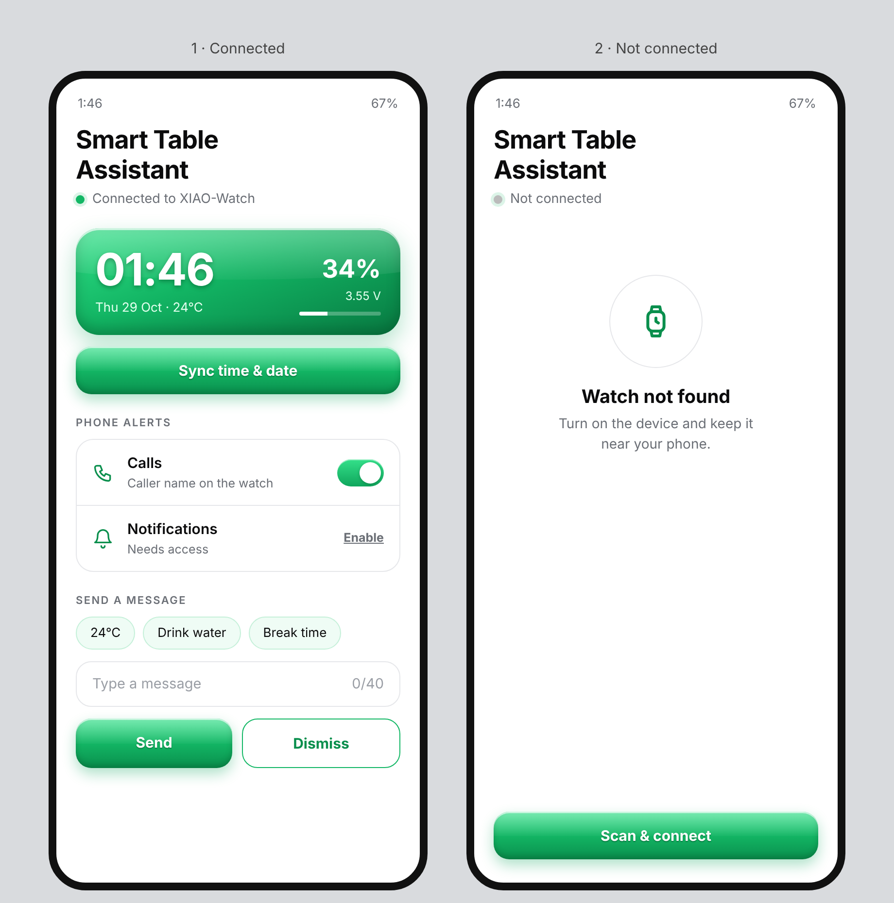
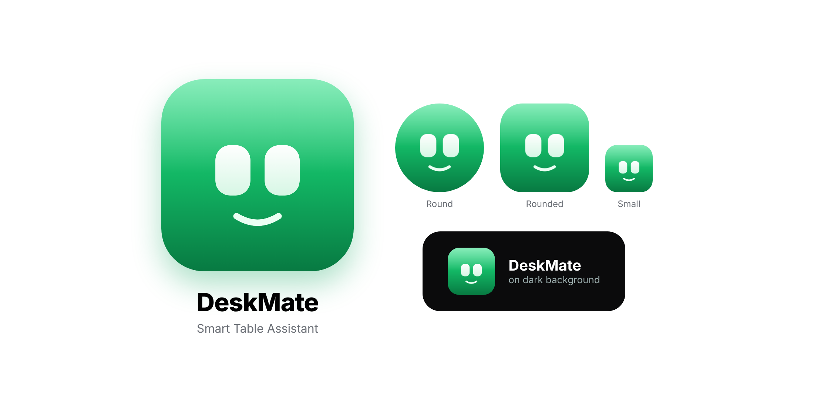

# DeskMate – Smart Table Assistant app

<p align="center"></p>

DeskMate is an Android app (React Native + Expo) that connects over Bluetooth Low Energy to the
[Smart Table Assistant](https://github.com/PinToCode/Smart-Table-Assistant-) desk companion
(Seeed XIAO nRF52840 Sense + OLED). It syncs the time, shows real phone calls and notifications on the
watch, sends messages and temperature, and shows the watch battery.

<p align="center"></p>

> The picture above is a design preview of the two main screens.

## Features

- Scan and connect to the watch (advertises as `XIAO-Watch`)
- Sync time and date from the phone
- Send temperature and short messages (up to 40 characters), and dismiss them
- Forward real incoming calls (caller name from your contacts) and phone notifications
- Live battery percentage and voltage

---

## Install the app (Android)

### Step 1 – Get the APK

**Option A: download a ready-made APK (no tools needed)**

1. Open the repository's **Actions** tab on GitHub and click the latest green **Build Android APK** run.
2. Under **Artifacts**, download `smart-table-assistant-apk`. It is a zip.
3. Unzip it on your PC. Inside is `app-release.apk`.
4. Copy it to your phone with a USB cable, or upload it to Google Drive and download it on the phone.
   Avoid sending it through WhatsApp or Bluetooth because the file can be damaged.

**Option B: build it yourself** – see [Build from source](#build-from-source).

### Step 2 – Install it on the phone

1. **Remove any older copy first.** Go to *Settings → Apps*, find DeskMate or Smart Table Assistant and uninstall it.
   An old copy signed with a different key causes **"App not installed"**.
2. **Allow installs from this source.** Open the APK from the *Files* app (or Chrome). When Android asks, turn on
   **Allow from this source** (Settings → Apps → Special app access → *Install unknown apps*).
3. **Play Protect.** If you see **"App blocked to protect your device"**, Google Play Protect is blocking it because the app
   asks for sensitive access (notifications, call log, contacts). Turn the scan off **before** installing:
   *Play Store → profile picture → Play Protect → gear icon → turn off **Scan apps with Play Protect***.
   Install the app, then turn Play Protect back on.
4. Tap **Install**, then **Open**.

### Step 3 – Give the app the access it needs

Open DeskMate. The **Phone alerts** card shows what is still missing.

| What | How |
| --- | --- |
| **Bluetooth** | Tap **Scan & connect** and allow *Nearby devices* (and *Location* on Android 11 or older). |
| **Calls** | Tap **Allow** next to *Calls* and allow *Phone*, *Call logs* and *Contacts*. |
| **Notifications** | Tap **Enable** next to *Notifications*, open **DeskMate** in the list and switch on **Allow notification access**. |

**If "Allow notification access" is greyed out** (Android 13 and newer), Android has *restricted* the setting because the app was
installed from an APK and not from the Play Store. Allow it by hand:

1. Go to *Settings → Apps → App management → DeskMate*.
2. Tap the **⋮** menu (top right) and choose **Allow restricted settings**. Confirm with your PIN or fingerprint.
3. Go back and switch on **Allow notification access**.

If the **⋮** option is missing, open the notification-access screen once, tap the greyed toggle so Android shows its
warning, then check the **⋮** menu again.

### Step 4 – Keep it running in the background

Calls and notifications are forwarded while the app process is alive. Stop your phone from closing it:

- *Settings → Battery → App battery management → DeskMate → **Unrestricted*** (the wording differs between brands).
- Do not swipe the app away from recent apps.
- On Xiaomi, Oppo, Realme, Vivo and OnePlus also enable **Auto-start**.

---

## Troubleshooting

| Problem | Fix |
| --- | --- |
| **App not installed** | Uninstall every older copy (also in *Clone apps / Second space / Work profile*). Copy the APK again by USB. Free about 200 MB. Check the exact error with `adb install -r app-release.apk`. |
| **App blocked to protect your device** | Turn off *Scan apps with Play Protect* before installing (Step 2.3). |
| **Notification access is greyed out** | *App info → ⋮ → Allow restricted settings* (Step 3). |
| **Watch not found** | Power on the device, keep it within a few metres, and check Bluetooth is on. Only one phone can connect at a time, so close other apps that use the watch. |
| **Calls show a number instead of a name** | Allow *Contacts* and *Call logs* (Step 3). |
| **Nothing arrives after a while** | Set battery to *Unrestricted* and do not swipe the app away (Step 4). |

---

## Build from source

You need Node.js 22 or newer, JDK 17 and the Android SDK (Android Studio), with `ANDROID_HOME` set.
In the SDK Manager install Platform 37, Build-Tools 37, NDK 27.1.12297006 and **CMake 3.22.1** and accept the licences.

```bash
git clone -b claude/jolly-heisenberg-9xi6uq https://github.com/alanjoseph77/STAssistant.git
cd STAssistant/app
npm install
npx expo prebuild --platform android --clean
cd android
./gradlew assembleRelease        # Windows: .\gradlew.bat assembleRelease
```

The APK is created at `app/android/app/build/outputs/apk/release/app-release.apk`.

Bluetooth needs native code, so **Expo Go does not work**. Use a build like the one above, or `npx expo run:android`.
The repository also has a GitHub Actions workflow (`.github/workflows/build-apk.yml`) that builds the APK for you.

---

## Watch Bluetooth map

Matches the `Smart_Table_Assistant.ino` firmware.

| Characteristic | UUID | Value |
| --- | --- | --- |
| time | `2A2B` | `HH:MM:SS` (24 hour) |
| date | `2A27` | `Wed 28 Oct` |
| weather | `2A24` | `24C` or `24, Clear` |
| notify | `2A46` | text up to 40 characters, `CLR` dismisses |
| call | `2A47` | caller up to 20 characters, `CLR` hangs up |
| battery level | `2A19` (service `180F`) | uint8 percent |
| battery voltage | `2A1A` (service `180F`) | float32 little-endian volts |

## Project layout

```
app/App.tsx                       screens
app/src/ble.ts, useWatch.ts       Bluetooth connection and writes
app/src/useForwarding.ts          call and notification forwarding
app/modules/watch-bridge/         native Android module (notification listener, call state)
app/assets/                       logo and icons
docs/                             README images
```

## Logo

<p align="center"></p>
